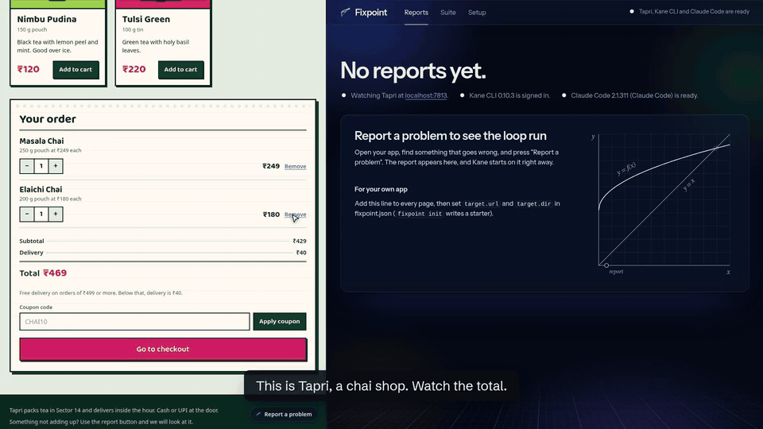
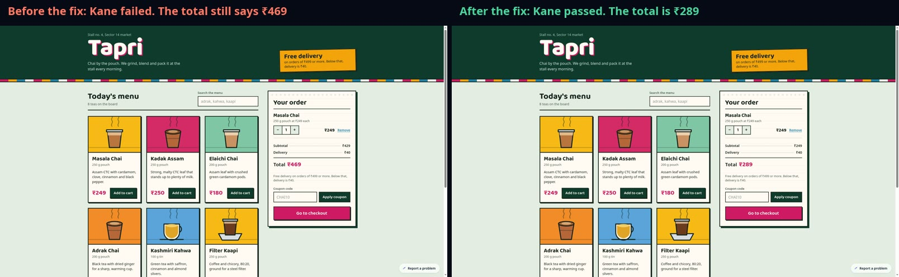
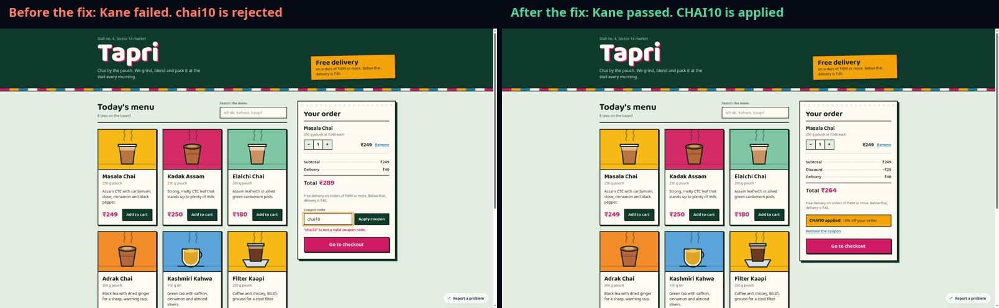
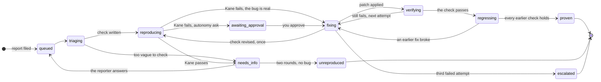

# Fixpoint

**Bug reports that close themselves.**

[](https://go.dev)
[](go.mod)
[](https://www.npmjs.com/package/@testmuai/kane-cli)
[](LICENSE)

Someone using your website finds something broken and presses **Report a problem**. They type
what went wrong in their own words. Fixpoint takes it from there, with nobody in the loop:

1. An AI coding agent (Claude Code) turns the report into a short test, written in plain English.
2. [Kane CLI](https://www.npmjs.com/package/@testmuai/kane-cli) runs that test in a real Chrome. If it fails, the bug is real, and now there are screenshots to prove it.
3. The agent fixes your code, with Kane's screenshots and failure in front of it.
4. Kane runs the same test again, and every test from earlier fixes too. Only when all of them pass is the report closed.

If three tries do not work, Fixpoint puts your code back exactly as it was and hands the
report to a person, with everything it found attached.

<p align="center">
  
</p>
<p align="center"><sub>A real run, recorded on 12 November 2026, with the waiting cut out. Nothing here is simulated.</sub></p>

## Try it in 30 seconds

No accounts needed for this part. Download the build for your computer, unpack it and start it:

| Your computer | Download |
|---|---|
| Linux (Intel or AMD) | [fixpoint_0.1.0_linux_amd64.tar.gz](https://github.com/Manas-Sehgxl/fixpoint/releases/latest/download/fixpoint_0.1.0_linux_amd64.tar.gz) |
| Linux (ARM) | [fixpoint_0.1.0_linux_arm64.tar.gz](https://github.com/Manas-Sehgxl/fixpoint/releases/latest/download/fixpoint_0.1.0_linux_arm64.tar.gz) |
| Mac (Apple chip) | [fixpoint_0.1.0_darwin_arm64.tar.gz](https://github.com/Manas-Sehgxl/fixpoint/releases/latest/download/fixpoint_0.1.0_darwin_arm64.tar.gz) |
| Mac (Intel) | [fixpoint_0.1.0_darwin_amd64.tar.gz](https://github.com/Manas-Sehgxl/fixpoint/releases/latest/download/fixpoint_0.1.0_darwin_amd64.tar.gz) |
| Windows | [fixpoint_0.1.0_windows_amd64.zip](https://github.com/Manas-Sehgxl/fixpoint/releases/latest/download/fixpoint_0.1.0_windows_amd64.zip) |

```sh
tar xzf fixpoint_0.1.0_*.tar.gz && cd fixpoint_0.1.0_*/
./fixpoint up --stubs
```

On Windows, unzip it and run `fixpoint.exe up --stubs`. On a Mac, if it says the app cannot
be opened because it is from an unidentified developer, run `xattr -d com.apple.quarantine fixpoint`
once and try again. If you have Go 1.24 or newer, you can
skip the download: clone this repository and run `go run ./cmd/fixpoint up --stubs`.

Then:

1. Open the demo shop, **Tapri**, at <http://localhost:4000>, and the Fixpoint console at
   <http://localhost:7777>. Put them side by side.
2. In the shop, add two teas to the cart, then remove one. The list changes, but the
   **Total** does not. That is one of five bugs planted in the shop.
3. Press **Report a problem** at the bottom right, type `I removed an item but the total
   didn't change` and send it.
4. Watch the console. The report is checked, reproduced, fixed and proven in about 11
   seconds. Reload the shop: the total is right now.

`--stubs` swaps Kane and Claude Code for simple stand-ins, so you can see the whole loop
without signing in to anything. The shop really gets fixed, but no real browser or AI is
used, and every page says so. The real thing is below.

## Proof from real runs

These are real runs from 12 November 2026, with Kane CLI 0.10.3 in Chrome and Claude Code.
The links open each run in TestMu's own Test Manager, so you can check the steps and
screenshots yourself.

**Report 1: "I removed the Elaichi Chai from my cart but the total did not change."**
Proven in 4 minutes 30 seconds, on the first try.



| Step | What Kane did | Result | Time | Kane run |
|---|---|---|---|---|
| Reproduce | Ran the new test on the shop as it was | Failed, as hoped: the total stayed at ₹469 | 75 s | [Open in Test Manager](https://test-manager.lambdatest.com/projects/01M77GWCPCE2F8BXYXREE4XNVV/test-cases/01M78CK96E4FQG3K16MCHB01CR/dashboard/share/US_OCXL02ZDXTPU3V6LKX3TSGGIGYDKW8Y85ZNH4OLNNJRKMPKSTNS9ENJNZS2TQFFG?type=summary&agentView=true&fqdn=summary-page) |
| Verify | Ran the same test after Claude Code's fix | Passed: the total is ₹289 | 54 s | [Open in Test Manager](https://test-manager.lambdatest.com/projects/01M77GWCPCE2F8BXYXREE4XNVV/test-cases/01M78CQETDEM01Y0DJB5D5KF8A/dashboard/share/US_Z9XOVUU5P51Q2XGYJX9QSDINSORTRVDKZRMDKER1WSOGC6W1LT11Y059XQWJWXH6?type=summary&agentView=true&fqdn=summary-page) |

The fix Claude Code wrote was one line in `js/cart.js`: removing an item now goes through
the same `commit()` as every other cart change, so the totals are worked out again.

**Report 2: "My coupon chai10 says invalid, it only works if I type CHAI10."**
Proven on the second try, and this one shows why the earlier tests matter.



| Step | What Kane did | Result | Time | Kane run |
|---|---|---|---|---|
| Reproduce | Ran the new coupon test | Failed, as hoped: chai10 was rejected | 89 s | [Open in Test Manager](https://test-manager.lambdatest.com/projects/01M77GWCPCE2F8BXYXREE4XNVV/test-cases/01M78EG99NJFBX0BF2WPD01BMG/dashboard/share/US_N39J9N9CCKKFCOA88BVC409ZXY8GFW4L4DXCVJP2DDAJQXYHIHBJTGOI5XH4CGZY?type=summary&agentView=true&fqdn=summary-page) |
| Verify, try 1 | Ran it after the coupon fix | Passed | 73 s | [Open in Test Manager](https://test-manager.lambdatest.com/projects/01M77GWCPCE2F8BXYXREE4XNVV/test-cases/01M78EMMZJ6D436YYYYD0YGPTE/dashboard/share/US_Z1J8E86A1M6P2QWH8LVDH3SR9R7UDDHP825HRI5EUIHERTL377BXG10GATTKH6X9?type=summary&agentView=true&fqdn=summary-page) |
| Replay report 1's test, try 1 | Checked that the cart fix still worked | **Failed: the cart fix was gone** | 131 s | recorded test replay |
| Verify, try 2 | Ran the coupon test again | Passed | 62 s | [Open in Test Manager](https://test-manager.lambdatest.com/projects/01M77GWCPCE2F8BXYXREE4XNVV/test-cases/01M78EXCJ09H3JEKGRH27KV752/dashboard/share/US_IKKOYCHXGJPJ3WR1HUWO8VAXWTUWT797Q2WYU98X2F5R3KDTYJS8PKN3JG6I7N2C?type=summary&agentView=true&fqdn=summary-page) |
| Replay report 1's test, try 2 | Checked the cart fix again | Passed | 79 s | [Open in Test Manager](https://test-manager.lambdatest.com/projects/01M77GWCPCE2F8BXYXREE4XNVV/test-cases/01M78CQETDEM01Y0DJB5D5KF8A/dashboard/share/US_Q1PZMUQM2DFUVT90O8C0LXNBHAH18BGFWX20XQR2ORSG8KWIGLCUR30BQNRS0MST?type=summary&agentView=true&fqdn=summary-page) |

On the first try the coupon fix worked, but Kane's replay of report 1's test caught that the
cart total was broken again. The cause was a bug in Fixpoint itself: a retry had restored an
old copy of the shop (fixed since, in commit 36108ac). Fixpoint did not count the try. It
gave Claude Code Kane's failing replay, and Claude Code put the cart fix back alongside the
coupon fix. Both tests passed, and only then was the report closed.

<p align="center">
  
</p>
<p align="center"><sub>The case file Fixpoint keeps for every report: what was wrong, what changed, and Kane's runs before and after.</sub></p>

## For judges

- **Quickest look:** the 30-second steps above. They need no accounts, and every page says the runs are simulated.
- **The real loop:** you need [Kane CLI](https://www.npmjs.com/package/@testmuai/kane-cli) signed in (`kane-cli login`), Claude Code, and Chrome. If you do not have Claude Code, it also runs on an Anthropic API key: set `ANTHROPIC_API_KEY` before starting. A capped key for judges is in the install command on our submission form. Then run `./fixpoint doctor` to check everything, and `./fixpoint up` without `--stubs`.
- **The proof:** the real runs above, with their Test Manager links.
- **The demo video:** shows one unbroken real session: Kane failing the check on the bug, Claude Code's fix, and Kane passing the same check.
- **Dates:** the repository was created on 12 November 2026; the first commit is at 01:37 IST that day. The history is as it was written.

## How it works

```
report  -->  Claude Code writes a test  -->  Kane runs it  --(fails: the bug is real)-->  Claude Code fixes the code
                                                                                                  |
          closed  <--(all pass)--  Kane replays every earlier test  <--(passes)--  Kane runs the same test again
```

The same test plays three parts. First it proves the bug exists, then it proves the fix
works, and after that it stays in the suite and is replayed after every later fix, so a new
fix cannot quietly break an old one. The agent's output is Kane's input, and Kane's output
is the agent's input. Nobody sits in between.

You can also hold each fix for approval with `--autonomy ask`, and nothing is ever
committed or deployed: Fixpoint leaves the change in your working copy for you to review.

## Use it on your own app

Run this in your own app's folder, not in the Fixpoint repo (a `fixpoint.json` with a
`target.url` turns the demo off):

```
fixpoint init    # from a clone: go run ./cmd/fixpoint init
```

It writes a commented `fixpoint.json` and prints the script tag. Every key is optional:

```json
{
  "target":   { "name": "My app", "url": "http://localhost:3000", "dir": ".",
                "notes": "Anything the agent should know: test data, where prices come from.",
                "restart_cmd": "", "health_url": "" },
  "kane":     { "bin": "kane-cli", "timeout_s": 240, "max_steps": 30,
                "bug_detection": "continue", "headless": true },
  "agent":    { "preset": "claude", "bin": "claude", "model": "", "timeout_s": 600 },
  "pipeline": { "max_attempts": 3, "autonomy": "auto", "max_info_rounds": 2 },
  "server":   { "addr": "127.0.0.1:7777", "shop_addr": "127.0.0.1:4000" }
}
```

- `target.url` is what Kane opens; `target.dir` is the source the agent patches. Setting
  `target.url` turns the demo off. Leave both empty for the demo shop.
- `target.notes` goes into both prompts. Use it for anything a new developer would need.
- `target.restart_cmd` runs after every patch and every rollback, then Fixpoint waits for
  `target.health_url` (or `target.url`) to answer before calling Kane. A static site or a
  dev server with hot reload needs neither.
- `autonomy: "ask"` holds each reproduced report at `awaiting_approval` until you approve.

Then add the widget to every page, just before `</body>`:

```html
<script src="http://localhost:7777/widget.js" data-fixpoint="http://localhost:7777" defer></script>
```

It renders in a shadow root, so it cannot touch your styles and your styles cannot touch
it. It sends the report text, the page address, the reporter's last 20 actions in plain
English and any errors the page logged, and it shows the reporter exactly what will be
sent before they send it. Fields that look like a password, email, phone, name, address or
card are recorded as `Typed in "Phone"`, never with their value.

<details>
<summary><b>Every status a report goes through</b></summary>



| Status | Who works | What happens | What moves it on |
|---|---|---|---|
| `triaging` | Claude Code | Reads the report, the conversation and your source, then writes one browser check, or decides to ask. | A check goes to Kane. A question goes to the reporter. |
| `reproducing` | Kane CLI | Runs the check in Chrome for the first time. **A failure is the good outcome**: the bug is real, with evidence. | Fails: on to fixing. Passes: the reporter gets the agent's follow-up question. |
| `needs_info` | the reporter | Answers one question in the widget or on the status page. | An answer queues the report again. Two rounds without a reproduction close it as `unreproduced`. |
| `fixing` | Claude Code | The app is snapshotted, then patched. The prompt carries Kane's steps, captured values, failure record and console errors. | A patch goes to Kane. A wrong check may be revised once, before any patch lands. |
| `verifying` | Kane CLI | Runs **the same check** against the patched app. | Still failing: the next attempt gets this run as evidence. Passing: on to regressing. |
| `regressing` | Kane CLI | Replays the saved check of **every earlier proven fix**. | One failure means the patch broke something, so it does not count. All pass: proven. |
| `proven` | nobody | The check joins the suite and the patch is saved as `fix.patch`. The case file shows the failing run, the patch and the passing run side by side. | Done. |
| `escalated` | you | Three attempts did not hold, or the agent gave up. The baseline is restored, so the app is exactly as it was. | Done, with everything Kane and the agent found attached. |

Two more statuses exist. `awaiting_approval` holds a reproduced report until you press
"Approve the fix", when Fixpoint runs with `--autonomy ask`. `error` means a tool stopped the
run, such as a missing sign-in or a timeout. Its message says what to do, and the report
can be retried.

One report is worked on at a time, because fixes change one working tree. The rest queue.
</details>

<details>
<summary><b>How Kane CLI is used, in detail</b></summary>

Kane has three distinct jobs in Fixpoint, and the layering is the point: the same check is
the reproducer, then the verifier, then a permanent regression test.

**1. Reproducer.** The check the agent just wrote is run against the live app. Exit 1 is
what Fixpoint wants here.

```
KANE_CLI_USER_AGENT=fixpoint kane-cli run "<objective>" --agent --headless \
  --url <start url> --timeout 240 --max-steps 30 --name fp-7-r1 [--bug-detection continue]
```

**2. Fix verifier.** After the agent patches the source, the identical objective runs
again. Exit 0 is what Fixpoint wants here; anything else feeds the next attempt.

```
KANE_CLI_USER_AGENT=fixpoint kane-cli run "<objective>" --agent --headless \
  --url <start url> --timeout 240 --max-steps 30 --name fp-7-v1 [--bug-detection continue]
```

**3. Regression suite.** Every proven check is kept. After any later patch verifies, each
earlier check runs again. `--name` on the runs above made Kane record a replayable test at
`.fixpoint/kane/.testmuai/tests/<slug>_test.md`, so the re-run replays the recording
instead of re-authoring the flow:

```
KANE_CLI_USER_AGENT=fixpoint kane-cli testmd run <slug>_test.md --agent --headless --timeout 240
```

When no saved test exists the suite run falls back to the `run` form above. The console's
"Run all checks" runs the whole suite the same way.

Details Fixpoint relies on:

- `--agent` switches Kane's stdout to NDJSON, one JSON object per line, and stdin must not
  be a terminal. Fixpoint parses `stream_start`, the untyped `{"step":n,"status":...}`
  progress lines (those are the steps you see arriving live in the console), `run_end` and
  the `test_md_*` stream, and ignores event types it does not know.
- `--bug-detection continue` is passed only if `kane-cli run --help` lists it, which is
  probed once, the first time Kane is run.
- Kane runs with its working directory set to `.fixpoint/kane/`, so its `.testmuai/` and
  its evidence packs land inside Fixpoint's data directory and not in your repo.
- The `.evidence` pack is opened for each run: step screenshots become
  `.fixpoint/artifacts/<report>/<run>/step-<n>.jpg` (or `.png`, as Kane wrote them), each
  step's `step.json` marks the failed one, the failure record is kept as text, and up to
  20 error-level browser console lines are collected. Both Kane 0.10's layout and the
  older one are read. A run with no pack is still a valid run.
- Credits, duration, `test_url` and Kane's own bug verdict, when it confirms one, are
  recorded per run and shown in the case file.

### The closed loop

```
   report text ---> agent (triage) ---> objective ---> Kane run ---> exit code
                                                                     + evidence
                                                                         |
        patch <--- agent (fix) <--- prompt carrying Kane's steps, <------+
          |                         reason, captured values, failure
          |                         record and browser console errors
          v
    Kane run (the same objective, unchanged) ---> exit code ---> proven,
                                                                or round again
```

Nothing in between is a person. The agent's output *is* Kane's input (the objective), and
Kane's output *is* the agent's input (the evidence block of the fix prompt). What each
exit code means to the pipeline:

| Exit | Kane | Reproduce run | Verify run | Regression run |
|---|---|---|---|---|
| 0 | passed | not reproduced -> `needs_info`, with the agent's follow-up question | the fix holds -> `regressing` | this earlier fix still holds -> next test |
| 1 | failed | **reproduced** -> `fixing` (or `awaiting_approval`) | still failing -> attempt `still_failing`, next attempt gets this evidence | attempt `regressed`; the patch does not count |
| 2 | error before or outside the run | `error`, retryable, with the remedy: sign in with `kane-cli login`, check Chrome | same | same |
| 3 | timeout or cancelled | `error`, retryable, suggesting a larger `kane.timeout_s` | same | same |

For `testmd run` there is no exit 3: a timeout ends as exit 1, failed.
</details>

<details>
<summary><b>Architecture and checking Fixpoint itself</b></summary>

```
cmd/fixpoint/          the CLI: up, doctor, init, demo reset, and the hidden stub runners
internal/core/         the shared types; their JSON encoding is the HTTP API contract
internal/pipeline/     the worker and the loop: triage, reproduce, fix, verify, regress
internal/kane/         running Kane CLI, parsing its NDJSON stream, reading evidence packs
internal/agent/        the Claude Code adapter and the two prompts, behind an interface
internal/snapshot/     copy, unified diff and restore of the target directory
internal/store/        one JSON file per report, the suite, atomic writes
internal/server/       the console API, the public API and both event streams
internal/{config,demo,doctor,events,proc,stub,view}/
web/console/           the console and the public status page: HTML, CSS, ES modules
web/widget/widget.js   the one file an app embeds
web/shop/              Tapri, the demo shop, with five planted bugs
web/dev/scenarios.json what the simulated runners know about those bugs
kane/                  Kane checks of Fixpoint's own console (see below)
scripts/kane-verify.sh runs them and reports failures back to a coding agent
docs/SPEC.md           the full build spec
```

Working data lives in `.fixpoint/` (git-ignored): `data/` the reports and the suite,
`artifacts/` screenshots and patches, `snapshots/` the baseline and per-attempt copies,
`kane/` Kane's working directory, `shop/` the demo shop copy that actually gets patched.

### Checking Fixpoint with Kane

`kane/` holds four checks of Fixpoint's own console, written as plain `.md` objective
files: a one-line title, a `Start URL:` line, a `Needs:` line saying what state the console
has to be in, and the objective itself as the last paragraph.
They are not Kane `_test.md` recordings, because a recording cannot be committed and
replayed on another machine. `scripts/kane-verify.sh` runs each one with the `run` form
above and prints what failed; it also works as a Claude Code Stop hook
(`.claude/settings.json`) so an agent editing the console is told when it broke the board.
The hook skips itself when `FIXPOINT_AGENT=1`, so Fixpoint's own agent can never trigger
it, skips when nothing is listening and when Kane CLI is absent, and gives up after three
blocks. Point it at another console with `FIXPOINT_URL` and `FIXPOINT_SHOP_URL` (the
checks' `localhost:7777` and `localhost:4000` are rewritten to them), and use `127.0.0.1`
rather than `localhost` where `localhost` resolves to IPv6. The check that files a report
needs `--stubs`, so it is skipped against real runners. Claude Code runs project hooks once
the folder is trusted; in a fresh clone, open `claude` there once, or pass the hook with
`--settings`.
</details>

<details>
<summary><b>What <code>--stubs</code> is, and is not</b></summary>

`--stubs` swaps in stand-in runners for development: no browser is driven and no model is
called. It exists so the loop can be worked on and tested without credentials, and because
the tests must be hermetic. With it on, the demo shop really is patched and really is
fixed, so the loop is faithful. The browser and the model are the only stand-ins. With them on,
the demo report in "the first two minutes" above reaches `proven` in about 11 seconds, with
`js/cart.js` really patched (+1 -4) and the check really saved as suite test 1.

**`--stubs` is not verification.** A simulated run proves nothing about your app. Fixpoint
says so everywhere it could be mistaken: `System.Simulated` and every `Run.Simulated` are
true, the console carries a notice on every page, each run block says "Simulated run: the
stub runner produced this, not a real browser", and the reporter's status view says
"Simulated run". Real verification needs your own machine, with Kane CLI signed in and
Claude Code installed, and `--stubs` left off.
</details>

<details>
<summary><b>Commands and flags</b></summary>

```sh
fixpoint up                 # console, demo shop and the loop
fixpoint up --stubs         # no accounts needed; nothing is verified
fixpoint doctor             # checks Kane CLI, the agent, Chrome and the target
fixpoint init               # writes a starter fixpoint.json for your own app
fixpoint demo reset --yes   # puts the demo shop back, clears reports and the suite
fixpoint version
```

Flags for `up`: `--addr` (console, default `127.0.0.1:7777`), `--shop-addr` (demo shop,
default `127.0.0.1:4000`), `--data` (working directory, default `.fixpoint`), `--stubs`,
`--autonomy auto|ask`. From a clone, put `go run ./cmd/fixpoint` in place of `fixpoint`.
</details>

## Not included, on purpose

Accounts and login. More than one target at a time. More than one report at a time.
Mobile targets. Deploying the patch, committing it or opening a pull request: Fixpoint
writes the diff and leaves it in your working tree. A database: reports are JSON files.
Any agent other than Claude Code, though the adapter is behind an interface so another
preset is a small job. No secrets are stored: Kane and the agent use their own sign-ins.

## Licence

MIT. See `LICENSE`.
