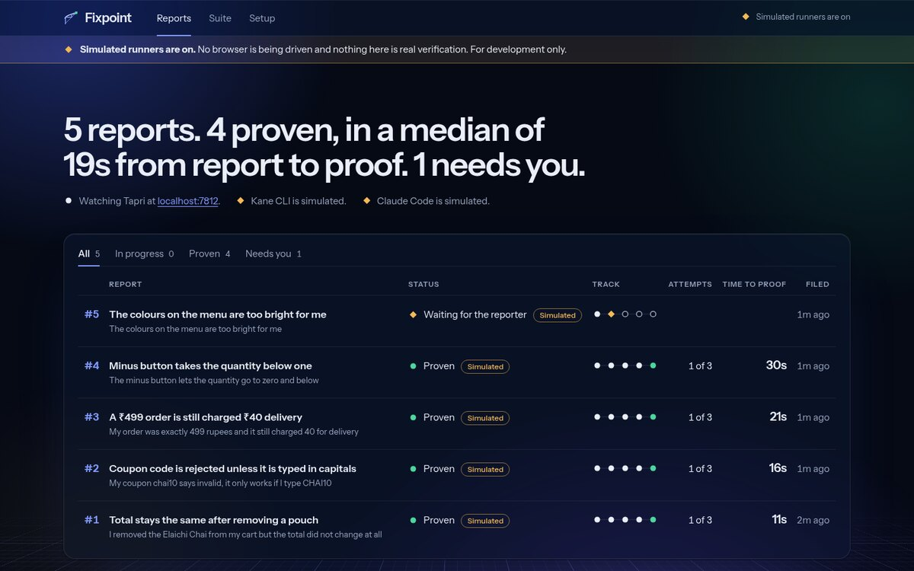
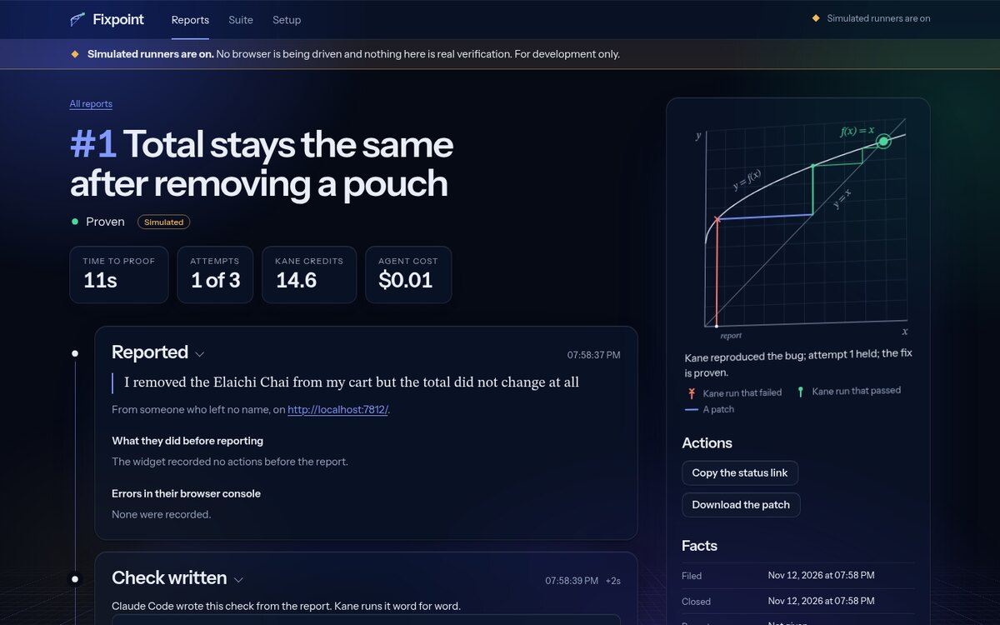
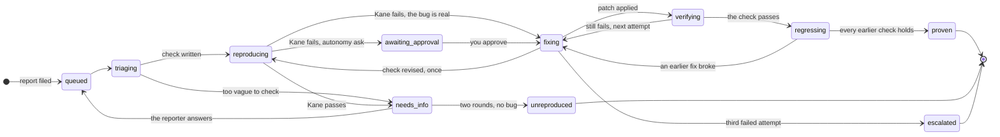

# Fixpoint

**Bug reports that close themselves.**

[](https://go.dev)
[](go.mod)
[](https://www.npmjs.com/package/@testmuai/kane-cli)
[](LICENSE)

A user clicks "Report a problem" in your web app and types what went wrong. Fixpoint takes it
from there, with nobody in the loop:

1. **Check.** Claude Code reads the report and your source and writes one plain-English
   browser check that fails while the bug exists.
2. **Reproduce.** Kane CLI runs that check in a real Chrome. A failure proves the bug is real.
3. **Fix.** Claude Code patches your source, with Kane's steps, screenshots and failure in
   the prompt.
4. **Prove.** Kane runs the same check again, then the check of every earlier fix. Only when
   all of them pass is the report closed, with the failing run, the patch and the passing
   run side by side.

Three failed attempts roll every patch back and hand the report to a person with everything
attached. The check stays behind as a regression test. The name is the idea: iterate until
the result stops changing.

<p align="center">
  
  
</p>
<p align="center"><sub>The board and a case file. These screenshots come from the demo with <code>--stubs</code>, so every run is marked Simulated.</sub></p>

## Contents

- [Quick start](#quick-start)
- [The first two minutes](#the-first-two-minutes)
- [How the loop works](#how-the-loop-works)
- [How Kane CLI is used](#how-kane-cli-is-used)
- [Point it at your own app](#point-it-at-your-own-app)
- [Architecture](#architecture)
- [Honesty, and what `--stubs` is not](#honesty-and-what---stubs-is-not)
- [Deliberately out of scope](#deliberately-out-of-scope)

## Quick start

You need four things on your machine:

| | |
|---|---|
| **Go 1.24 or newer** | Fixpoint is one binary built from the standard library only. No `go get`. |
| **Kane CLI** | `npm install -g @testmuai/kane-cli`, then `kane-cli login`. Every check runs in Kane, in a real browser, on your machine. |
| **Claude Code** | Installed and signed in. It writes the checks and the patches. |
| **Chrome** | Kane drives it. |

Check them, then start everything:

```sh
go run ./cmd/fixpoint doctor   # says what is missing and what to type
go run ./cmd/fixpoint up       # console on :7777, demo shop on :4000, the loop
```

`doctor` exits 1 while something required is missing, so it fits in a setup script. No
credentials yet? `go run ./cmd/fixpoint up --stubs` runs the whole loop with simulated
runners, and every page says nothing was verified.

<details>
<summary>All commands and flags</summary>

```sh
go run ./cmd/fixpoint up                 # console, demo shop and the loop
go run ./cmd/fixpoint up --stubs         # no credentials needed; nothing is verified
go run ./cmd/fixpoint doctor             # is Kane CLI, the agent, Chrome and the target ready
go run ./cmd/fixpoint init               # write a starter fixpoint.json for your own app
go run ./cmd/fixpoint demo reset --yes   # re-seed the demo shop, clear reports and the suite
go run ./cmd/fixpoint version
```

Flags for `up`: `--addr` (console, default `127.0.0.1:7777`), `--shop-addr` (demo shop,
default `127.0.0.1:4000`), `--data` (working directory, default `.fixpoint`), `--stubs`,
`--autonomy auto|ask`.

`demo reset --yes` is for a stopped Fixpoint. While one is running, use "Reset the demo" on
the console's Setup page, which also clears what the running process holds in memory.

</details>

## The first two minutes

1. `go run ./cmd/fixpoint up`. Open the console at <http://localhost:7777> and the demo
   shop, **Tapri**, at <http://localhost:4000>. Put them side by side.
2. In the shop, add a couple of pouches of chai to the cart, then remove one. The list
   changes; the **Total** does not. That is a real bug in `js/cart.js`, one of five
   planted in the shop.
3. Press **Report a problem** at the bottom right and type, in your own words:
   `I removed an item but the total didn't change`. Send it.
4. Watch the console. The report appears on the board, Claude Code writes a check, Kane
   runs it and fails it, Claude Code patches `js/cart.js`, Kane runs the same check again
   and it passes. The case file at `/reports/{id}` shows the whole thing: the steps Kane
   took, its screenshots, the unified diff, and the failing and passing screenshots side
   by side.
5. Reload the shop. The total updates now. The check you caused is on the **Suite** page,
   and it will be run again after every later patch.

## How the loop works

Every report moves through the statuses below. The names are the real ones from
`internal/core/types.go`, and the console shows each one live.



| Status | Who works | What happens | What moves it on |
|---|---|---|---|
| `triaging` | Claude Code | Reads the report, the conversation and your source, then writes one browser check, or decides to ask. | A check goes to Kane. A question goes to the reporter. |
| `reproducing` | Kane CLI | Runs the check in Chrome for the first time. **A failure is the good outcome**: the bug is real, with evidence. | Fails: on to fixing. Passes: the reporter gets the agent's follow-up question. |
| `needs_info` | the reporter | Answers one question in the widget or on the status page. | An answer queues the report again. Two rounds without a reproduction close it as `unreproduced`. |
| `fixing` | Claude Code | The app is snapshotted, then patched. The prompt carries Kane's steps, captured values, failure record and console errors. | A patch goes to Kane. A wrong check may be revised once, before any patch lands. |
| `verifying` | Kane CLI | Runs **the same check** against the patched app. | Still failing: the next attempt gets this run as evidence. Passing: on to regressing. |
| `regressing` | Kane CLI | Replays the saved check of **every earlier proven fix**. | One failure means the patch broke something, so it does not count. All pass: proven. |
| `proven` | nobody | The check joins the suite and the patch is saved as `fix.patch`. The case file shows the failing run, the patch and the passing run side by side. | Done. |
| `escalated` | you | Three attempts did not hold, or the agent gave up. The baseline is restored, so the app is exactly as it was. | Done, with everything Kane and the agent found attached. |

Two more statuses exist. `awaiting_approval` holds a reproduced report until you press
"Approve the fix", when Fixpoint runs with `--autonomy ask`. `error` means a tool stopped the
run, such as a missing sign-in or a timeout. Its message says what to do, and the report
can be retried.

One report is worked on at a time, because fixes change one working tree. The rest queue.

## How Kane CLI is used

Kane has three distinct jobs in Fixpoint, and the layering is the point: the same check is
the reproducer, then the verifier, then a permanent regression test.

**1. Reproducer.** The check the agent just wrote is run against the live app. Exit 1 is
what Fixpoint wants here.

```
KANE_CLI_USER_AGENT=fixpoint kane-cli run "<objective>" --agent --headless \
  --url <start url> --timeout 240 --max-steps 30 --name fp-7-r1 [--bug-detection continue]
```

**2. Fix verifier.** After the agent patches the source, the identical objective runs
again. Exit 0 is what Fixpoint wants here; anything else feeds the next attempt.

```
KANE_CLI_USER_AGENT=fixpoint kane-cli run "<objective>" --agent --headless \
  --url <start url> --timeout 240 --max-steps 30 --name fp-7-v1 [--bug-detection continue]
```

**3. Regression suite.** Every proven check is kept. After any later patch verifies, each
earlier check runs again. `--name` on the runs above made Kane record a replayable test at
`.fixpoint/kane/.testmuai/tests/<slug>_test.md`, so the re-run replays the recording
instead of re-authoring the flow:

```
KANE_CLI_USER_AGENT=fixpoint kane-cli testmd run <slug>_test.md --agent --headless --timeout 240
```

When no saved test exists the suite run falls back to the `run` form above. The console's
"Run all checks" runs the whole suite the same way.

Details Fixpoint relies on:

- `--agent` switches Kane's stdout to NDJSON, one JSON object per line, and stdin must not
  be a terminal. Fixpoint parses `stream_start`, the untyped `{"step":n,"status":...}`
  progress lines (those are the steps you see arriving live in the console), `run_end` and
  the `test_md_*` stream, and ignores event types it does not know.
- `--bug-detection continue` is passed only if `kane-cli run --help` lists it, which is
  probed once, the first time Kane is run.
- Kane runs with its working directory set to `.fixpoint/kane/`, so its `.testmuai/` and
  its evidence packs land inside Fixpoint's data directory and not in your repo.
- The `.evidence` pack is opened for each run: step screenshots become
  `.fixpoint/artifacts/<report>/<run>/step-<n>.jpg` (or `.png`, as Kane wrote them), each
  step's `step.json` marks the failed one, the failure record is kept as text, and up to
  20 error-level browser console lines are collected. Both Kane 0.10's layout and the
  older one are read. A run with no pack is still a valid run.
- Credits, duration, `test_url` and Kane's own bug verdict, when it confirms one, are
  recorded per run and shown in the case file.

### The closed loop

```
   report text ---> agent (triage) ---> objective ---> Kane run ---> exit code
                                                                     + evidence
                                                                         |
        patch <--- agent (fix) <--- prompt carrying Kane's steps, <------+
          |                         reason, captured values, failure
          |                         record and browser console errors
          v
    Kane run (the same objective, unchanged) ---> exit code ---> proven,
                                                                or round again
```

Nothing in between is a person. The agent's output *is* Kane's input (the objective), and
Kane's output *is* the agent's input (the evidence block of the fix prompt). What each
exit code means to the pipeline:

| Exit | Kane | Reproduce run | Verify run | Regression run |
|---|---|---|---|---|
| 0 | passed | not reproduced -> `needs_info`, with the agent's follow-up question | the fix holds -> `regressing` | this earlier fix still holds -> next test |
| 1 | failed | **reproduced** -> `fixing` (or `awaiting_approval`) | still failing -> attempt `still_failing`, next attempt gets this evidence | attempt `regressed`; the patch does not count |
| 2 | error before or outside the run | `error`, retryable, with the remedy: sign in with `kane-cli login`, check Chrome | same | same |
| 3 | timeout or cancelled | `error`, retryable, suggesting a larger `kane.timeout_s` | same | same |

For `testmd run` there is no exit 3: a timeout ends as exit 1, failed.

## Point it at your own app

Run this in your own app's directory, not in the Fixpoint repo (a `fixpoint.json` with a
`target.url` in the repo root turns the demo off):

```
go run ./cmd/fixpoint init
```

It writes a commented `fixpoint.json` and prints the script tag. Every key is optional:

```json
{
  "target":   { "name": "My app", "url": "http://localhost:3000", "dir": ".",
                "notes": "Anything the agent should know: test data, where prices come from.",
                "restart_cmd": "", "health_url": "" },
  "kane":     { "bin": "kane-cli", "timeout_s": 240, "max_steps": 30,
                "bug_detection": "continue", "headless": true },
  "agent":    { "preset": "claude", "bin": "claude", "model": "", "timeout_s": 600 },
  "pipeline": { "max_attempts": 3, "autonomy": "auto", "max_info_rounds": 2 },
  "server":   { "addr": "127.0.0.1:7777", "shop_addr": "127.0.0.1:4000" }
}
```

- `target.url` is what Kane opens; `target.dir` is the source the agent patches. Setting
  `target.url` turns the demo off. Leave both empty for the demo shop.
- `target.notes` goes into both prompts. Use it for anything a new developer would need.
- `target.restart_cmd` runs after every patch and every rollback, then Fixpoint waits for
  `target.health_url` (or `target.url`) to answer before calling Kane. A static site or a
  dev server with hot reload needs neither.
- `autonomy: "ask"` holds each reproduced report at `awaiting_approval` until you approve.

Then add the widget to every page, just before `</body>`:

```html
<script src="http://localhost:7777/widget.js" data-fixpoint="http://localhost:7777" defer></script>
```

It renders in a shadow root, so it cannot touch your styles and your styles cannot touch
it. It sends the report text, the page address, the reporter's last 20 actions in plain
English and any errors the page logged, and it shows the reporter exactly what will be
sent before they send it. Fields that look like a password, email, phone, name, address or
card are recorded as `Typed in "Phone"`, never with their value.

## Architecture

```
cmd/fixpoint/          the CLI: up, doctor, init, demo reset, and the hidden stub runners
internal/core/         the shared types; their JSON encoding is the HTTP API contract
internal/pipeline/     the worker and the loop: triage, reproduce, fix, verify, regress
internal/kane/         running Kane CLI, parsing its NDJSON stream, reading evidence packs
internal/agent/        the Claude Code adapter and the two prompts, behind an interface
internal/snapshot/     copy, unified diff and restore of the target directory
internal/store/        one JSON file per report, the suite, atomic writes
internal/server/       the console API, the public API and both event streams
internal/{config,demo,doctor,events,proc,stub,view}/
web/console/           the console and the public status page: HTML, CSS, ES modules
web/widget/widget.js   the one file an app embeds
web/shop/              Tapri, the demo shop, with five planted bugs
web/dev/scenarios.json what the simulated runners know about those bugs
kane/                  Kane checks of Fixpoint's own console (see below)
scripts/kane-verify.sh runs them and reports failures back to a coding agent
docs/SPEC.md           the full build spec
```

Working data lives in `.fixpoint/` (git-ignored): `data/` the reports and the suite,
`artifacts/` screenshots and patches, `snapshots/` the baseline and per-attempt copies,
`kane/` Kane's working directory, `shop/` the demo shop copy that actually gets patched.

### Checking Fixpoint with Kane

`kane/` holds four checks of Fixpoint's own console, written as plain `.md` objective
files: a one-line title, a `Start URL:` line, a `Needs:` line saying what state the console
has to be in, and the objective itself as the last paragraph.
They are not Kane `_test.md` recordings, because a recording cannot be committed and
replayed on another machine. `scripts/kane-verify.sh` runs each one with the `run` form
above and prints what failed; it also works as a Claude Code Stop hook
(`.claude/settings.json`) so an agent editing the console is told when it broke the board.
The hook skips itself when `FIXPOINT_AGENT=1`, so Fixpoint's own agent can never trigger
it, skips when nothing is listening and when Kane CLI is absent, and gives up after three
blocks.

## Honesty, and what `--stubs` is not

`--stubs` swaps in stand-in runners for development: no browser is driven and no model is
called. It exists so the loop can be worked on and tested without credentials, and because
the tests must be hermetic. With it on, the demo shop really is patched and really is
fixed, so the loop is faithful. The browser and the model are the only stand-ins. With them on,
the demo report in "the first two minutes" above reaches `proven` in about 11 seconds, with
`js/cart.js` really patched (+1 -4) and the check really saved as suite test 1.

**`--stubs` is not verification.** A simulated run proves nothing about your app. Fixpoint
says so everywhere it could be mistaken: `System.Simulated` and every `Run.Simulated` are
true, the console carries a notice on every page, each run block says "Simulated run: the
stub runner produced this, not a real browser", and the reporter's status view says
"Simulated run". Real verification needs your own machine, with Kane CLI signed in and
Claude Code installed, and `--stubs` left off.

## Deliberately out of scope

Accounts and login. More than one target at a time. More than one report at a time.
Mobile targets. Deploying the patch, committing it or opening a pull request: Fixpoint
writes the diff and leaves it in your working tree. A database: reports are JSON files.
Any agent other than Claude Code, though the adapter is behind an interface so another
preset is a small job. No secrets are stored: Kane and the agent use their own sign-ins.

## Licence

MIT. See `LICENSE`.
